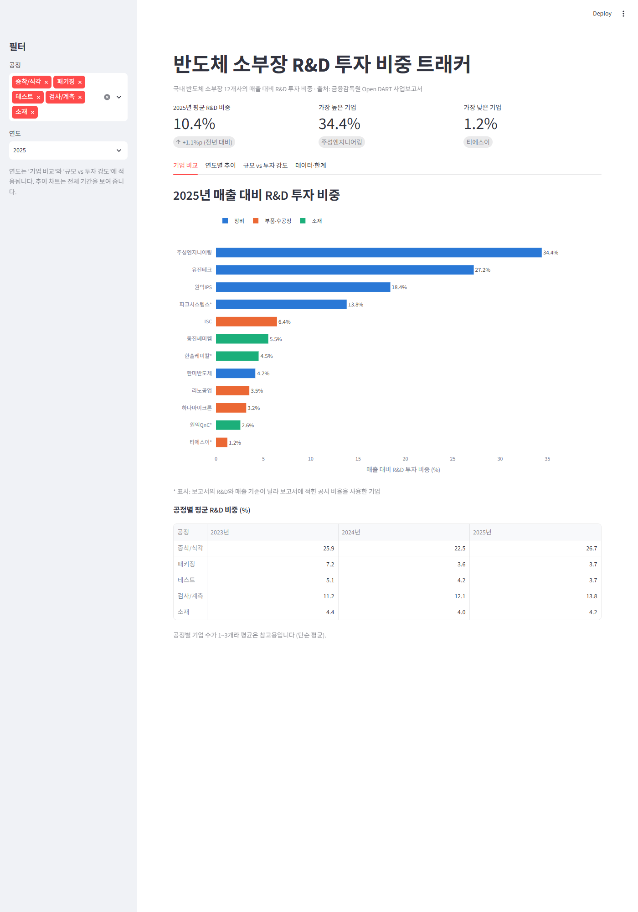
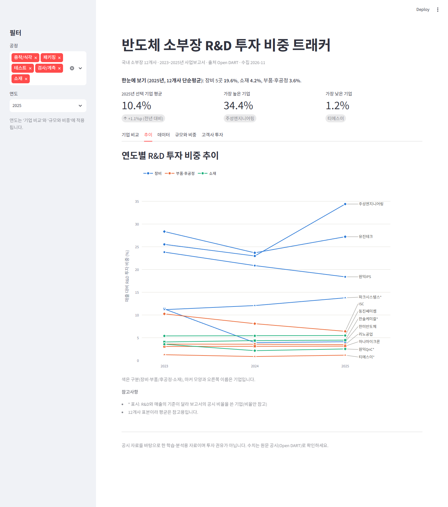
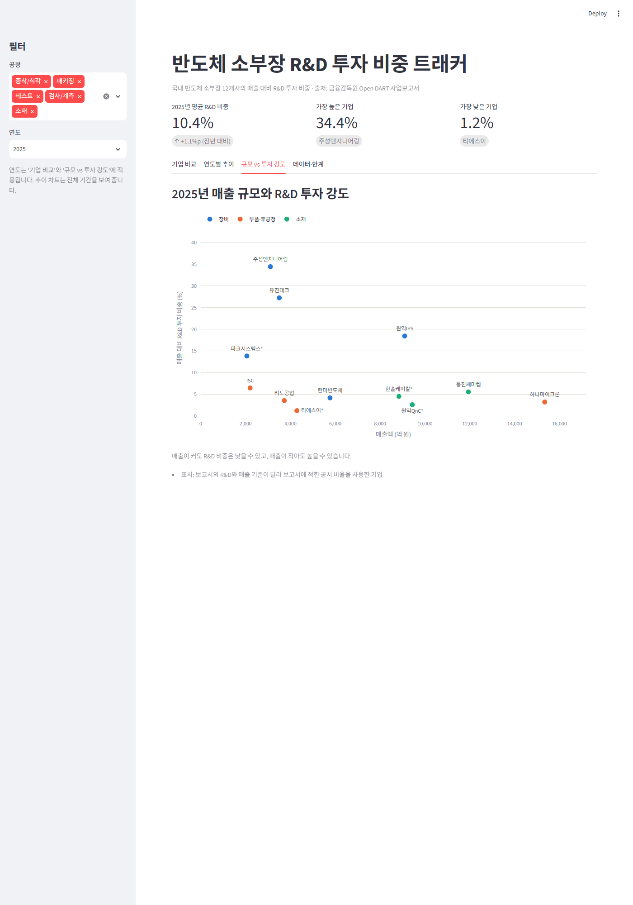
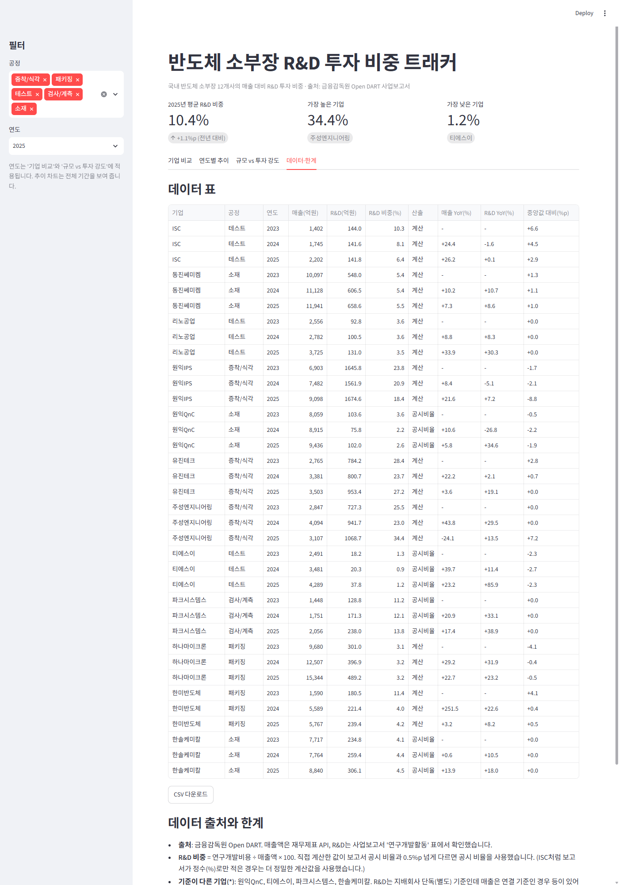

# 반도체 소부장 R&D 투자 비중 트래커

국내 반도체 소부장(소재·부품·장비) 12개사의 **매출 대비 R&D 투자 비중**을 DART 공시로 수집·분석해 Streamlit 대시보드로 보여 줍니다. (2023~2025, 12개사 × 3개년 = 36행. 비교 기준선으로 쓰는 고객사 삼성전자·SK하이닉스 6행을 더해 `master.csv`는 모두 42행입니다.)

추가로, 고객사(삼성전자·SK하이닉스)의 설비투자가 장비사 5곳의 매출과 얼마나 같이 움직였는지도 분기 단위로 살펴봤습니다(아래 "추가 분석").

> 배포 링크: https://semicondutor-rnd-tracker-ivpokny3wutyfwkvnmcpia.streamlit.app/
> 프로젝트 소개(2쪽): [project_overview.pdf](project_overview.pdf)

## 왜 만들었나
소재·부품·장비 기업은 모두 "기술로 먼저 개발해 고객사에 인정받아야 팔 수 있는" 회사로 묶여 불리지만, 연구개발에 쓰는 돈의 크기는 업종마다 다르다고 생각했습니다. 장비는 고객사의 새 공정에 맞춰 장비를 먼저 개발해야 하는 산업이라 R&D 비중이 구조를 잘 보여 줄 것이라 보았고, 이 차이를 느낌이 아니라 공시된 숫자로 직접 확인하고 숫자 뒤의 이유를 스스로 해석해 보았습니다.

## 화면




<!-- 스크린샷 갱신 예정: 5번째 탭('고객사 투자 vs 장비 매출') 캡처 추가, 기존 4장도 현재 화면으로 교체 -->

대시보드 구성 (사이드바에서 공정·연도를 고르면 기업 비교·규모 vs 투자 강도에 같은 조건이 적용됩니다. 5번째 탭은 필터와 무관합니다)
- **기업 비교**: 선택한 연도의 R&D 비중 가로 막대 + 공정별 평균 표. 삼성전자·SK하이닉스는 막대가 아니라 점선 '기준선'으로만 표시하고(각 사 전사 연결 기준), 12개사 평균·순위에는 넣지 않았습니다.
- **연도별 추이**: 2023~2025 기업별 R&D 비중 선 그래프
- **규모 vs 투자 강도**: 매출(가로)과 R&D 비중(세로) 산점도
- **고객사 투자 vs 장비 매출**: 삼성전자·SK하이닉스 설비투자와 장비사 5곳 매출의 분기별 증가율, 시차별 상관계수, 회사별 비교, 연 단위 표
- **데이터**: 전체 데이터 표(CSV 다운로드)와 출처 설명. 한계는 별도 탭 없이 각 탭 맨 아래 회색 '참고사항'에 둡니다.

색은 기업이 아니라 **구분(장비 / 부품·후공정 / 소재)** 에만 썼습니다. 기업이 12개라 기업별 색은 구분이 어렵기 때문입니다.

## 인사이트 3가지
숫자는 공시에서 가져온 사실이고, "왜"는 제가 숫자에서 끌어낸 **해석(가설)** 입니다.

### 1. 장비 기업의 R&D 비중이 소재·부품보다 훨씬 높다
| 구분 (2025, 단순평균) | R&D 비중 |
|---|---|
| 장비 (5개사) | 약 19.6% |
| 소재 (3개사) | 약 4.2% |
| 부품·후공정 (4개사) | 약 3.6% |

증착/식각 장비는 18.4~34.4%, 소재는 2.6~5.5%였습니다.
**해석**: 장비는 고객사의 새 공정에 맞춰 장비를 먼저 개발해야 팔 수 있는 "기술 선행형"이고, 소재·부품은 검증된 제품을 꾸준히 파는 "양산형" 비중이 커서 매출 대비 R&D가 낮게 나옵니다.
**한계**: 소재는 3개사뿐이라 평균은 참고용이고, 한미반도체(패키징 장비)는 4.2%로 낮아 장비라고 모두 높지는 않습니다.

### 2. 비중은 'R&D를 얼마나 썼나'보다 '매출이 어떻게 변했나'에 크게 흔들린다
- **한미반도체**: 2023→2024 매출이 약 3.5배(1,590억→5,589억)가 되는 동안 R&D는 +22.6%(180억→221억). 금액은 늘었는데 비중은 **11.4% → 4.0%**.
- **주성엔지니어링**: 2025년 매출이 24% 줄었는데 R&D는 13.5% 늘어서 비중이 **23.0% → 34.4%**.
- **원익IPS**: R&D는 1,646억→1,675억으로 거의 같은데 매출이 늘어 비중은 23.8% → 18.4%.

**해석**: 비중은 "R&D ÷ 매출"이라 분모(매출)가 급변하면 R&D를 그대로 두어도 값이 크게 움직입니다. 비중이 높다고 투자를 많이 한 것은 아니므로 금액과 매출 증감을 같이 봐야 합니다.
**얼마나 일반적인가**: 공시 비율을 쓴 4개사는 R&D·매출 기준이 달라 빼고, 나머지 8개사의 16개 구간(연도 간 변화)을 확인했습니다. 비중이 2%p 이상 움직인 8번 중 7번은 R&D 증감보다 매출 증감이 더 컸습니다(예외: 유진테크 2025, R&D +19.1%로 비중 +3.5%p). 반대로 동진쎄미켐·리노공업·하나마이크론은 매출과 R&D가 비슷하게 늘어 비중이 거의 그대로였습니다. 즉 "매출에 흔들린다"는 비중이 **크게 변한** 경우에 해당하고 매년 맞는 말은 아닙니다.

### 3. 같은 공정 안에서도 기업별 편차가 크다
- **테스트(2025)**: ISC 6.4%, 리노공업 3.5%, 티에스이* 1.2% (최대 약 5배)
- **증착/식각(2025)**: 18.4% ~ 34.4% (약 16%p 차이)

**해석**: 같은 공정이라도 매출 규모와 사업 구조가 달라 비중이 갈립니다. 예를 들어 원익IPS는 R&D 금액이 3사 중 가장 크지만(1,675억) 매출이 더 커서 비중은 가장 낮습니다. 그래서 공정 평균은 참고용이고 기업을 하나씩 봐야 합니다.
**추이로 본 편차**: ISC는 2023→2025에 매출이 약 57% 늘었는데 R&D는 144억→142억으로 거의 그대로여서 비중이 10.3% → 6.4%로 내려갔습니다. 같은 테스트 공정의 리노공업은 3.6% → 3.5%로 거의 그대로입니다.
**한계(정의 차이)**: 편차 일부는 R&D 집계 기준 차이입니다. 주성엔지니어링의 R&D 총액은 국고보조금 차감 후라 차감 전으로 맞추면 2025년 34.4% → 36.1%이고, 유진테크는 개발비 자산화분(71.5억원)이 들어 있어 빼면 27.2% → 25.2%입니다. 이렇게 맞춰도 증착/식각 3사의 순위와 큰 격차는 그대로입니다.

## 추가 분석: 고객사 설비투자와 장비사 매출
"고객사가 투자를 늘리면 장비사 매출도 늘까?"를 확인했습니다. 이 부분은 **가설을 세우는 수준의 관찰**이고, 인과를 주장하지 않습니다.
- **데이터**: 설비투자(CAPEX)는 두 회사 현금흐름표의 '유형자산의 취득'입니다. 장비사 5곳(원익IPS, 주성엔지니어링, 유진테크, 한미반도체, 파크시스템스)의 매출은 분기보고서의 누적값을 빼서 분기로 만들었습니다(2021Q1~2026Q3, 23개 분기). 증가율은 계절 영향을 줄이려고 '작년 같은 분기 대비'로 계산했습니다.
- **같은 분기에는 함께 움직인 경향**: SK하이닉스 투자와 장비사 매출 증가율의 상관계수는 +0.66(95% 범위 +0.29~+0.85, 표본 19개)입니다. 다만 인접한 분기끼리 값이 비슷해 독립 표본이 적습니다. 한쪽 계열을 한 칸씩 돌려 짝을 어긋나게 해도 이만큼 센 상관이 나오는 비율(순열 p값)은 약 0.10이라 확정하기는 어렵습니다.
- **'투자가 먼저, 매출이 나중'이라는 증거는 약함**: 시차(0분기부터 4분기까지)를 늘리면 SK하이닉스 상관은 약해지다가 3분기·4분기 뒤에는 음수(-0.40, -0.62)로 뒤집힙니다. 표에서 가장 센 값은 고객사 합계 3분기 뒤 -0.82인데, 투자를 늘리면 매출이 준다는 진짜 관계라기보다 증가율의 기저효과와 약 1년 주기의 업황 때문에 생긴 착시일 가능성이 큽니다(**추정**. 4분기 전과의 자기상관이 두 계열 모두 음수인 점이 근거이고, 직접 검증하지는 못했습니다).
- **15개 조합을 한꺼번에 봤습니다**(고객사 3종 × 시차 5개). 우연히 '눈에 띄는' 값이 몇 개 나올 수 있어서 개별 숫자를 크게 해석하지 않았습니다.
- **회사별로 쪼개 보기**: 고객 집중도(사업보고서 주요 고객 비중, 계약 공시)가 높은 유진테크는 SK하이닉스와의 상관이 +0.63으로 가장 높고, 고객이 분산된 파크시스템스는 +0.05였습니다. 그러나 주성엔지니어링처럼 계약의 59%가 SK하이닉스인데도 상관이 +0.18인 회사가 있어 가설을 확정할 수 없습니다. 회사가 5곳뿐이라 통계 검정도 못 합니다.

## 추가 분석의 한계
- 삼성전자 설비투자는 전사 연결 기준이라 디스플레이·하만 등의 투자가 섞여 있고, 현금흐름표 값이라 미지급금 변동·리스·무형자산 취득은 반영되지 않습니다.
- 장비는 수주 → 출하 → 설치·검수(매출 인식)에 수개월 이상 걸려서, 투자를 집행한 시점과 매출이 잡히는 시점이 어긋날 수 있습니다.
- 장비사 매출에는 중국·미국 등 다른 고객사도 들어 있습니다. 파크시스템스는 계측 장비라 팹 설비투자와의 연동이 약할 수 있습니다.
- 사업보고서의 주요 고객은 'A사, B사'로 이름이 가려져 있어 삼성전자인지 SK하이닉스인지 알 수 없습니다. 계약 공시는 큰 계약만 나오고 기간이 회사마다 다릅니다(예: 유진테크는 2022년 8월까지). 주성엔지니어링의 '기타' 계약에는 LG디스플레이·EnCORE Group LLC(태양광 관련으로 추정) 등 반도체 외 계약이, 한미반도체는 2021년 소액 계약이 많이 섞여 있습니다.
- 연 단위 비교는 표본이 4개 해뿐이고, 분기 증가율 상관도 표본이 15~19개입니다.
- **고객사는 삼성전자·SK하이닉스 둘뿐입니다.** 반도체 제조사가 둘뿐이라는 뜻이 아니라, 국내 장비사의 국내 납품처가 이 둘에 몰려 있고 설비투자를 DART에서 같은 방식으로 모을 수 있어서 골랐습니다. DB하이텍(파운드리), Micron·Intel·TSMC의 R&D 비중은 대시보드 '기업 비교' 탭의 참고 표로만 넣었고(`data/manual/customer_fabs.csv`, DART·SEC 원문 수동 입력) 설비투자 상관 분석에는 넣지 못했습니다. 그래서 해외·파운드리 고객에게서 나온 장비사 매출은 상관 분석이 설명하지 못합니다. TSMC 2025년 값은 확인하지 못해 비웠습니다.

## 데이터 수집과 검증
- **출처**: 금융감독원 Open DART. 매출은 재무제표 API(`fnlttSinglAcntAll`), R&D는 사업보고서 "연구개발활동" 표에서 확인했습니다. 연결 재무제표를 먼저, 없으면 별도(리노공업)를 썼습니다.
- **R&D는 수동 입력**: API로 자동 추출되는 R&D는 7/36뿐이어서(본표에 없는 회사가 많음) 보고서 표에서 직접 입력하고 행마다 출처를 `source_note`에 적었습니다. 자동값은 참고용입니다.
- **비중 계산**: 기본은 `R&D ÷ 매출 × 100`. 보고서에 적힌 공시 비율과 비교해서, **한 해라도 0.5%p 넘게 다르면 그 회사는 3개년 모두 공시 비율**을 씁니다(한 회사 안에서 계산 방식이 섞이면 추이가 왜곡되기 때문). 해당 기업은 화면에 `*`로 표시합니다: 한솔케미칼, 원익QnC, 티에스이, 파크시스템스.
- **ISC처럼 공시가 정수(%)로만 적힌 경우**: 계산값과 0.5%p 이내이면 더 정밀한 계산값을 씁니다(공시 6% → 화면 6.4%).
- **데이터가 이상할 때 확인한 사례**: 동진쎄미켐 매출이 2025년에 -15%로 나왔고, 보고서의 R&D와 공시 비율로 역산한 매출과 약 3,000억 차이가 났습니다. 원인은 2025년 보고서에서 과거 매출이 **재작성**(2023년 13,099억 → 10,097억)된 것이었습니다. 3개년 매출을 최신 보고서 기준으로 통일하자 계산값이 공시 비율과 일치했습니다. 나머지 11개사는 같은 방식으로 비교해 차이가 없음을 확인했습니다.

## 한계
- 표본이 12개사뿐이고 공정당 기업 수가 1~3개라 평균은 참고용입니다(단순 평균). 위 "추가 분석의 한계"도 함께 봐 주세요.
- 4개사는 R&D와 매출의 기준이 달라 공시 비율을 썼습니다. 티에스이는 지배회사 단독 R&D라 자회사 R&D가 빠져 있습니다.
- 증착/식각 장비의 높은 비중(약 18~34%)은 보고서 표 값과 일치하지만, 개발비 자산화 포함 여부 같은 정의 차이는 더 확인이 필요합니다.
- "왜 그런가"는 데이터에서 끌어낸 해석이라 외부 요인(수요 변화 등)까지 증명하지는 못합니다.
- R&D 비중이 높다고 좋은 기업은 아닙니다.

## 유의 사항
- 이 프로젝트는 공개된 공시 자료를 바탕으로 한 **학습·분석용**이며, 특정 종목에 대한 투자 권유나 조언이 아닙니다. 수치에는 입력·해석상의 오류가 있을 수 있으니 투자 판단 전에 원문 공시를 확인하세요.
- 데이터 출처: 금융감독원 전자공시시스템 Open DART (https://opendart.fss.or.kr).
- 라이선스: 코드는 [MIT License](LICENSE)를 따릅니다. 공시 데이터의 권리는 각 출처에 있습니다.

## 실행 방법
```bash
# 1. 가상환경 만들고 패키지 설치
python -m venv venv
venv\Scripts\activate
pip install -r requirements.txt

# 2. 프로젝트 폴더에 .env 파일을 만들고 Open DART API 키를 넣습니다
#    DART_API_KEY=발급받은키

# 3. 순서대로 실행 (data/manual/ 의 R&D·고객 집중도는 이미 입력되어 있습니다)
python collect_data.py          # 연간 매출·R&D 후보 수집
python metrics.py               # R&D 비중 계산 -> master.csv
python analyze_capex.py         # 고객사 설비투자 vs 장비사 매출 (연 단위)
python collect_quarterly.py     # 분기 데이터 수집 -> quarterly.csv
python analyze_quarterly.py     # 시차별 상관계수 -> lag_corr.csv
python collect_contracts.py     # 장비사 공급계약 공시 수집 -> contracts.csv
python analyze_exposure.py      # 장비사별 고객 집중도·상관 -> exposure.csv
streamlit run app.py
```
`data/processed/` 안의 CSV(`master.csv`, `capex.csv`, `quarterly.csv`, `lag_corr.csv`, `contracts.csv`, `exposure.csv`)가 이미 들어 있으면 API 키 없이 `streamlit run app.py`만으로 대시보드를 볼 수 있습니다. 다만 CSV를 새로 만들려면 위 순서대로 실행해야 하고, 수집 단계에는 API 키가 필요합니다.

## 폴더 구조
```
├── companies.csv            # 분석 대상 12개사 + 고객사 2곳(기준선·설비투자 비교용)
├── collect_data.py          # DART에서 연간 매출 + R&D 후보 수집
├── metrics.py               # 수동 R&D와 합쳐 비중 계산 -> master.csv
├── analyze_capex.py         # 고객사 설비투자 vs 장비사 매출 (연 단위) -> capex.csv
├── collect_quarterly.py     # 분기 설비투자·매출 수집 -> quarterly.csv
├── analyze_quarterly.py     # 시차별 상관계수·신뢰구간·순열 p값 -> lag_corr.csv
├── collect_contracts.py     # 장비사 단일판매·공급계약 공시 수집 -> contracts.csv
├── analyze_exposure.py      # 장비사별 고객 집중도·상관 -> exposure.csv
├── app.py                   # Streamlit 대시보드 (5개 탭)
├── insights.md              # 인사이트 메모
├── project_overview.pdf     # 프로젝트 소개 (왜 했나, 무엇을 만들었나)
├── screenshot/              # 대시보드 탭별 화면 캡처
└── data/
    ├── manual/
    │   ├── rnd_manual.csv              # 사업보고서에서 직접 입력한 R&D
    │   └── customer_concentration.csv  # 사업보고서 주요 고객 비중 (직접 입력)
    └── processed/                      # financials / master / capex / quarterly / lag_corr / contracts / exposure .csv
```
